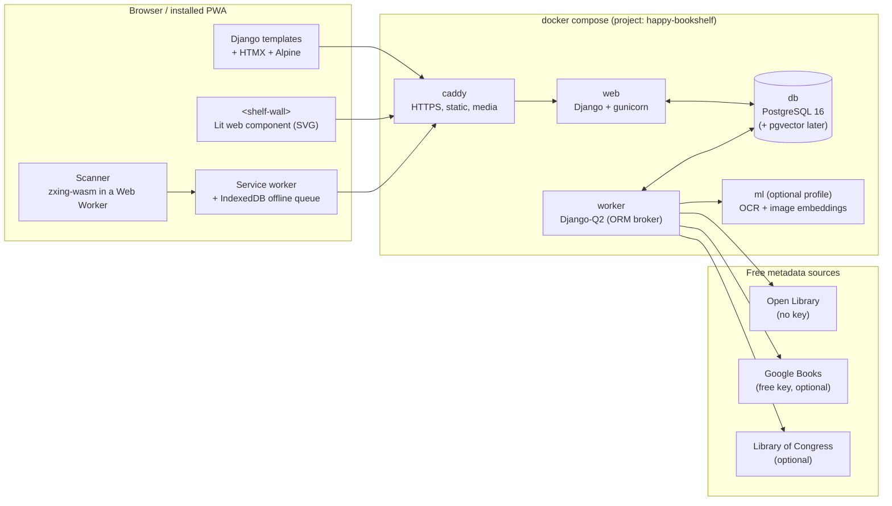

# Architecture

> **Status:** Proposal — Planning Session 0 (2026-10-13)
> **Name:** `happy-bookshelf`

This document explains how the app is put together and why. It is updated at the end of every planning session and sprint. Decisions that are still open are marked **🟡 Open**.

---

## 1. Goals and constraints

| # | Requirement | How the architecture answers it |
|---|---|---|
| 1 | Identify books by ISBN scan, later by cover/spine | In-browser barcode decoding (zxing-wasm); later a local OCR + image-matching worker |
| 2 | Low-cost scanning hardware | The phone you already own. Optional USB/Bluetooth HID scanner. Later: Raspberry Pi scan station |
| 3 | Low/zero API cost | Free, keyless sources first (Open Library), aggressive local caching, no paid APIs in the default path |
| 4 | Persistent, secure, later redundant storage | PostgreSQL in a named volume, per-user isolation, encrypted off-site backups (restic) in a later phase |
| 5 | New titles feed a global lookup | A separate **Commons** catalog (bibliographic data only, CC0), with provenance; optional upstream contribution to Open Library |
| 6 | Custom views | `View` definitions stored as data (fields, filters, sort, grouping, layout) |
| 7 | PWA, OS-independent | Installable PWA with service worker, offline scan queue |
| 8 | Django, non-React frontend | Django + HTMX + Alpine.js for pages; Lit web components for the interactive shelf |
| 9 | Physical-location model, virtual shelves | Bookcase → Shelf → linear "run"; arrangement strategies; SVG spines with real dimensions |
| 10 | Documentation-first | `docs/` updated every session; ADRs for decisions; CHANGELOG |
| 12 | Beautiful UI for book and art lovers | Typographic, warm design system built from open-licence fonts and a paper-and-ink palette |

**Non-goals for v1:** multi-tenant hosting, social features, lending/loan tracking (good v2 candidate), native mobile apps.

---

## 2. System overview



### Containers

| Service | Image base | Purpose | Notes |
|---|---|---|---|
| `caddy` | `caddy:2` | TLS termination, static + media files | Required: browsers only allow camera access over HTTPS (or `localhost`). Caddy's internal CA covers LAN use; Tailscale certs cover remote use |
| `web` | `python:3.13-slim` | Django app, HTML + JSON API | Dependencies managed with `uv` |
| `worker` | same image as `web` | Background jobs: metadata lookup, cover download, colour extraction | Django-Q2 using Postgres as its broker, so **no Redis container** |
| `db` | `postgres:16` | All persistent data | Named volume `happy-bookshelf_pgdata` |
| `ml` | `python:3.13-slim` + OCR libs | Cover/spine recognition | Compose **profile** — off by default, so the base install stays light |

All base images are published for `linux/arm64`, which matters for the Windows-on-Arm dev machine and for a Raspberry Pi later.

---

## 3. Book identification

### 3.1 ISBN scanning (Phase 1)

1. The camera stream runs in the browser. Frames are decoded by **zxing-wasm** in a Web Worker.
2. If the browser exposes a native `BarcodeDetector` with EAN-13 support (Chrome on Android does), use it; otherwise fall back to zxing-wasm. Desktop Chrome/Edge support is only partial and Safari ships it disabled by default, so the fallback is the primary path, not an edge case.
3. Only EAN-13 codes starting with `978`/`979` are accepted as ISBNs. ISBN-10 is converted to ISBN-13 on entry.
4. A scan becomes a **ScanEvent** in IndexedDB first. The service worker syncs it to the server, so scanning works in a basement with no signal.
5. The server returns a provisional match immediately from cache, or queues a lookup job.

**Continuous-scan mode:** the camera stays open; each new ISBN gives a soft chime and a card slides into a tray. This is the fastest way to catalogue a whole shelf.

### 3.2 Scanning hardware

| Tier | Hardware | Cost | When |
|---|---|---|---|
| 0 | Any phone with a camera, running the PWA | Free | Phase 1 |
| 1 | USB or Bluetooth HID barcode scanner (types digits like a keyboard) | Inexpensive (low tens of dollars; prices vary) | Phase 1 — a focused input field catches the keystrokes |
| 2 | Raspberry Pi + camera module on a small stand, posting to the same API | Low | Phase 3 — a "scan station" for spines and covers |

### 3.3 Cover and spine recognition (Phase 3)

Runs entirely locally in the `ml` container, so there is no per-request API cost:

- **Spines:** detect text regions → OCR (Tesseract or PaddleOCR) → fuzzy-match title/author tokens against the local cache, then Open Library search. One photo of a whole shelf becomes many candidate books, each confirmed by the user.
- **Covers:** compute an image embedding (open_clip) and a perceptual hash; nearest-neighbour search in `pgvector` against covers already cached. Good for books without barcodes (older, pre-1970).
- **Optional:** a local vision model through Ollama for hard cases. Never required.

🟡 **Open:** which OCR engine performs acceptably on arm64 CPU only. Benchmark in the Phase 3 spike.

---

## 4. Metadata lookup (zero-cost chain)

Lookups go through a chain and stop at the first good result:

1. **Local cache** — every `Edition` ever fetched.
2. **Commons** — the shared catalog (section 6).
3. **Open Library** Books API — free, no key, CC0 metadata.
4. **Google Books** — optional; needs a free API key; fills gaps such as page count and descriptions.
5. **Library of Congress** — optional; strong for subject headings and call numbers.

Rules:

- Raw responses are stored (`SourceRecord`) with source and timestamp, then normalised into our models. Re-normalising never needs a re-fetch.
- **Covers:** request cover images by Open Library **cover ID**, not by ISBN. The ISBN-based covers endpoint is rate-limited per IP; the cover-ID path is not. Covers are downloaded once and stored in `media/`.
- A polite `User-Agent` with the project URL and contact address is sent on every request.
- Each field records where it came from, so the UI can show "page count from Google Books, edited by you".

---

## 5. Data model (core)

```
User ──< Library ──< Copy >── Edition >── Work >──< Author
                       │         │
                       │         └──< Cover (image, dominant colours, embedding)
                       │
                       ├── Placement >── Shelf >── Bookcase >── Room
                       └──< Tag

Library ──< View          (saved custom views)
Library ──< Arrangement   (virtual shelf orderings)
Edition ──< SourceRecord  (raw API payloads with provenance)
Edition ──< Contribution  (user-submitted corrections, feeds Commons)
```

- **Work / Edition / Copy** follows library practice: *Work* is the abstract book, *Edition* is a specific printing with an ISBN, *Copy* is the object on your shelf (condition, signed, acquired date, notes).
- **Physical dimensions** live on `Edition` (`height_mm`, `width_mm`, `thickness_mm`) and can be overridden per `Copy`. When unknown, thickness is estimated from page count and flagged as estimated.
- **Per-user isolation:** every query on user data is scoped through `Library`. Enforced in one queryset manager, plus tests that try to read across libraries.

---

## 6. Commons: the shared catalog

The Commons is how new titles and corrections help everyone.

- **What goes in:** bibliographic facts only — title, authors, ISBNs, dimensions, page count, cover image, spine photo.
- **What never goes in:** ownership, location, notes, ratings, or anything that reveals what a person owns.
- **Licence:** contributions are CC0, matching Open Library, so data can flow both ways.
- **Provenance and trust:** every contribution records who, when and from what evidence (for example, "measured with a ruler"). Several agreeing contributions raise confidence.
- **Upstream first:** where Open Library is missing a record, offer to contribute it back to Open Library rather than only keeping it in our own Commons.

🟡 **Open:** in Phase 1 the Commons is just a table inside each instance. A central, hosted Commons (or federation between instances) is a later decision with its own costs and moderation needs.

---

## 7. Custom views

A `View` is saved data, not code:

```json
{
  "name": "Art books by size",
  "layout": "grid",            // grid | list | table | shelf
  "fields": ["cover", "title", "author", "height_mm"],
  "filters": [{"field": "tags", "op": "contains", "value": "art"}],
  "sort": [{"field": "height_mm", "dir": "desc"}],
  "group_by": "publisher"
}
```

Views render server-side through Django templates and HTMX, so they stay fast and need no client framework. Built-in defaults: *Gallery* (covers), *Ledger* (dense table), *Shelf* (spines).

---

## 8. Virtual shelves

### 8.1 Physical model

- **Bookcase** has shelves; each **Shelf** has usable `width_mm`, `height_mm`, `depth_mm`.
- All shelves join end to end into one **linear run** (total millimetres of shelf space). This is the abstraction the arrangement engine works on; it does not need to know the room's real layout.
- A **Placement** puts a copy at an offset (mm) on a shelf. Placements can be *actual* (where it is now) or belong to a hypothetical **Arrangement**.

### 8.2 Arrangement engine

1. Choose an ordering strategy: author, title, colour (spectrum), height, publication date, genre/subject, LCC or Dewey call number, or a custom view's sort.
2. Lay books along the linear run in that order (first-fit), respecting each shelf's height. Books too tall for a shelf are flagged or moved to the next shelf that fits.
3. Report the result: shelf fill percentage, overflow, wasted space, number of books that would move compared with the current arrangement.

Strategies are plain Python classes in `catalog/arrangements/`, so contributors can add new ones easily.

### 8.3 Rendering

- `<shelf-wall>` is a **Lit** web component that draws shelves and spines as SVG, scaled from real millimetres. Drag-and-drop moves a spine and posts the new placement through the JSON API.
- **Spines, version 1:** a standard spine — width from thickness, height from height, colour from the cover's dominant colour, title and author set vertically in the display serif.
- **Spines, later:** a real spine photo (from the scan station) replaces the generated one when available.
- 🟡 **Open:** SVG is fine up to a few thousand books on screen. If performance suffers, switch the renderer to Canvas (PixiJS) behind the same component interface.

---

## 9. Frontend

**Why not React:** most screens are lists, forms and detail pages, which Django templates plus HTMX handle with far less code and no build pipeline. The one heavily interactive surface, the shelf wall, gets its own small web component instead of a whole SPA framework.

| Concern | Choice |
|---|---|
| Page interactions | HTMX |
| Small client state (menus, toggles) | Alpine.js |
| Shelf wall, scanner | Lit web components |
| Styling | Plain CSS with custom properties (design tokens), no utility framework |
| Build | None for most pages; `esbuild` only for the web components |
| PWA | Web app manifest + Workbox service worker |

### Design direction

For people who love books and art:

- **Type:** a literary serif for display and reading (for example *Fraunces* or *EB Garamond*) paired with a quiet sans for UI chrome. Open-licence fonts only, self-hosted.
- **Palette:** paper, ink, cloth-binding colours; a "reading room at night" dark mode.
- **Texture and motion:** subtle paper grain, gentle page-turn and slide transitions, honouring `prefers-reduced-motion`.
- **Covers are the art:** generous whitespace, covers shown large, chrome kept quiet.

A design-system page (`/styleguide`) documents tokens and components from the first UI sprint.

---

## 10. Storage, security and backups

- **Database:** PostgreSQL 16 in a named volume. Media (covers, spine photos) in a separate named volume.
- **Auth:** Django auth with Argon2 password hashing; sessions over HTTPS only; CSRF on all forms and HTMX requests.
- **Network:** in development, ports bind to `127.0.0.1` only. LAN access (for phone scanning) goes through Caddy with HTTPS.
- **Secrets:** `.env` file, never committed; `.env.example` documents every variable.
- **Backups (Phase 2):** nightly `pg_dump` + media → **restic** repository (encrypted). Target can be a local disk, a home server, or low-cost object storage.
- **Redundancy (later):** a second restic target off-site; documented restore drill.
- **Export:** full library export to CSV and JSON at any time. Your data is yours.

---

## 11. Development environment (Windows on Arm)

Detailed in Sprint 2. Principles:

- Docker Desktop for Windows on Arm with the WSL 2 backend; all images `linux/arm64`.
- Source code lives inside the WSL filesystem for file-watch speed.
- **No collisions with other projects:**
  - fixed compose project name (`name: happy-bookshelf`), so containers, networks and volumes are prefixed;
  - non-default host ports (for example `8740` for HTTPS, Postgres not published at all);
  - a per-repo SSH host alias (Sprint 1) so this repo's Git identity never touches other projects' keys.

---

## 12. Deployment path

1. **Local** — Windows-on-Arm laptop, `docker compose up`.
2. **Home server** — same compose file on an always-on machine; remote access over Tailscale.
3. **Public demo** — behind a small VPS / reverse proxy, read-only demo library.

---

## 13. Roadmap

| Phase | Theme | Key deliverables |
|---|---|---|
| 0 | Foundations | Repo, SSH isolation, arm64 dev env, Claude Code setup, docs skeleton |
| 1 | Catalogue | Django skeleton, compose stack, ISBN scan, lookup chain, Copy CRUD, Gallery/Ledger views, PWA install |
| 2 | Shelves | Bookcase/shelf model, linear run, arrangement engine, `<shelf-wall>`, backups |
| 3 | Recognition | Spine OCR, cover matching, scan station, Commons contributions |
| 4 | Share | Public demo, contributor guide, first tagged release (see *Open-source readiness*) |

### Phase 0 sprints

| Sprint | Goal |
|---|---|
| 1 | Create the repo on GitHub and locally; isolate its SSH identity from other projects |
| 2 | Decide and set up the arm64 Windows dev architecture without conflicting with existing projects |
| 3 | Set up and tune Claude Code for this project (CLAUDE.md, permissions, commands, hooks) |
| 4 | **Shelf prototype (moved up):** throwaway virtual shelf with ~50 real books; validate that arranging spines is genuinely useful before building Commons or recognition |

### Open-source readiness (added in Session 0)

These run alongside the phases rather than waiting for Phase 4. Each one has an owner phase so it isn't forgotten.

| Item | Target | First appears |
|---|---|---|
| **Showcase:** a striking GIF or live demo page of the virtual shelf near the top of the README | Visitors understand the idea in five seconds | GIF from the Sprint 4 shelf prototype; live demo page in Phase 4 |
| **Two-minute quick start** that actually works | `git clone` → `docker compose up` → working app, tested on a clean machine for every release | Phase 1 |
| **Architecture docs and decision records** | `docs/ARCHITECTURE.md` updated every session; one ADR per decision in `docs/adr/` | Phase 0 (now) |
| **Contributor on-ramp:** friendly `CONTRIBUTING.md`, issue templates, labelled `good first issue`s | At least five well-scoped first issues at any time | `CONTRIBUTING.md` in Phase 0; first issues in Phase 1 |
| **Visibly thoughtful design:** design system, `/styleguide` page, screenshots in the README | The design is the project's calling card | Tokens and styleguide in the first UI sprint; screenshots from Phase 1 |

### Measuring books (decided in Session 0)

Rulers fixed along the shelf edges serve as a scale reference. A photo of the shelf is taken, the ruler gives millimetres-per-pixel, and spine edges marked (by hand first, automatically later) are converted to widths by coordinate distance. Perspective correction is needed if the photo isn't square to the shelf; printed fiducial markers (for example ArUco) at the ruler ends are a candidate for making this robust.

---

## 14. Open decisions

| ID | Question | Options | Leaning |
|---|---|---|---|
| D-1 | Project name | — | ✅ `happy-bookshelf` |
| D-2 | Code licence | AGPL-3.0 (forks that host it must share changes) · MIT (maximum adoption) | ✅ MIT, chosen for visibility and low friction for contributors and adopters |
| D-3 | Data licence for Commons | CC0 | CC0, to stay compatible with Open Library |
| D-4 | Task queue | Django-Q2 (ORM) · Celery + Redis | Django-Q2: one fewer container |
| D-5 | Shelf renderer | SVG · Canvas (PixiJS) | SVG first |
| D-6 | OCR engine | Tesseract · PaddleOCR | Benchmark in Phase 3 |

Decisions, once made, are recorded as ADRs in `docs/adr/`.